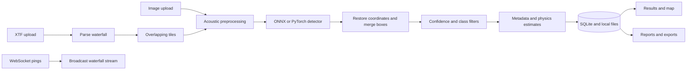

<p align="center">
  
</p>

<p align="center">
  <a href="https://github.com/ritesh123malik/sihnew/actions/workflows/ci.yml"></a>
  <a href="frontend/package.json"></a>
  <a href="#requirements"></a>
  <a href="#technology"></a>
  <a href="#tests-and-quality"></a>
  <a href="#license"></a>
</p>

<p align="center"><strong>AI-assisted marine debris and anomaly detection from side-scan sonar images and XTF surveys.</strong><br />Upload a scan. Inspect detections. Explore the map. Export the evidence.</p>

<p align="center">
  <a href="#quick-start">Quick start</a> ·
  <a href="#demo-and-operator-workflow">Try the demo</a> ·
  <a href="docs/architecture.md">Architecture</a> ·
  <a href="docs/api.md">API reference</a> ·
  <a href="https://github.com/ritesh123malik/sihnew/issues">Report an issue</a>
</p>

> **Project status:** Sonaris is a research and demonstration application developed in the Smart India Hackathon 2026 context. The scan, inference, persistence, and reporting paths are implemented; experimental and simulated capabilities are identified below. The badge version belongs to the frontend package, not a published platform release.

## Demo and operator workflow

Start both services with the [quick start](#quick-start), then open **[Sonaris locally](http://localhost:5173)**. No hosted-demo availability is claimed here.

<details>
<summary><strong>Preview a bundled sonar input</strong></summary>


This is a **source-data example**, not a screenshot of the Sonaris interface or a verified detection result. Use the same image in the first API example below.

</details>

| Step | Screen | What you can do |
| :--- | :--- | :--- |
| **01 · Configure** | `/` | Select an image or XTF file; set position, sonar type, resolution, depth range, and class filters. |
| **02 · Analyze** | `/results/:runId` | Inspect detection boxes, class confidence, risk summaries, and available anomaly details. |
| **03 · Revisit** | `/uploads` | Browse stored scan runs and reopen their results. |
| **04 · Locate** | `/map` | Explore detection positions on a Leaflet map. |
| **05 · Report** | `/reports` | Browse reports and export results for downstream review. |
| **06 · Stream** | `/live-survey` | Inspect waterfall visualization and use the XTF/image ingestion controls. Some displayed telemetry is demonstrative. |

**A successful first run:** the backend health response is available, the uploaded scan receives a `run_id`, and its results can be reopened from Uploads. Zero detections is a valid outcome; a sample image is not a guarantee of a particular class or score.

## What Sonaris does

Sonar surveys capture large areas of seabed, but reviewing every return manually is demanding. Sonaris combines acoustic image preprocessing, a trained detector, and a browser-based review workflow to help an operator identify and organize candidate underwater objects.

### Core capabilities

| Capability | Implementation |
| :--- | :--- |
| **Image and survey ingestion** | JPEG, PNG, TIFF, and Triton XTF uploads; file signature checks and a configurable 500 MB default limit. |
| **Acoustic preprocessing** | Beam-angle correction, FFT stripe attenuation, homomorphic sharpening, and optional shadow inpainting before model inference. |
| **Object detection** | Ultralytics checkpoint loading, ONNX Runtime support with PyTorch fallback, class filtering, and confidence controls. |
| **Large-waterfall analysis** | Overlapping XTF tiles, restoration to waterfall coordinates, and global non-maximum suppression. |
| **Detection review** | Bounding boxes, class/confidence/risk summaries, cropped anomaly patches, and shadow-related estimates. |
| **Survey history** | SQLite-backed runs, detections, and reports, with local upload/output storage. |
| **Mapping and exports** | Detection coordinates, CSV, JSON, GeoJSON, KML, PDF dossiers, and specialized geospatial endpoints. |
| **Streaming transport** | WebSocket broadcast of waterfall pings and supplied detections; binary XTF records can be rendered into ping rows. |
| **Observability** | Health/readiness/liveness endpoints, request IDs, rate limiting, and Prometheus metrics. |
| **Optional cloud integration** | Supabase services and schema for cloud data integration; local operation does not require credentials. |

### Detection classes

The checked-in [run metadata](model/run_config.json) identifies a **YOLO11s** model and five classes. The serving code reads names from the loaded model; replacing a checkpoint can change its labels.

| ID | Class | Default final confidence cutoff |
| ---: | :--- | ---: |
| 0 | Shipwreck | 0.3263 |
| 1 | Aircraft | 0.5265 |
| 2 | Submarine pipeline | 0.7497 |
| 3 | Ghost net | 0.8138 |
| 4 | Mine / munitions | 0.2893 |

Cutoffs come from [model/per_class_thresholds.csv](model/per_class_thresholds.csv). Leaving the launch confidence slider untouched omits `confidence_threshold`, allowing these class-specific filters. Supplying an integer percentage selects the final global filter; it cannot restore candidates already removed inside the detector.

### Experimental features and current boundaries

- **D-GRM graph reasoning and model-level SADH:** opt-in through `USE_DGRM=true` and `USE_SADH=true`; both are off by default. The detect route separately adds heuristic shadow-height and physics-confidence fields.
- **Shadow inpainting:** off by default. Telea, Navier–Stokes, and GAN-related implementations exist; validate a chosen method and its weights before relying on it.
- **Live inference:** the mounted WebSocket handler broadcasts pings and caller-provided detections. It does **not** run the detector on each incoming ping.
- **Bathymetry:** the upload endpoint estimates relief from shadow geometry. The salvage mesh endpoint generates synthetic terrain; its `run_id` does not make that terrain survey-derived.
- **Recovery planning:** salvage routes use stored detections when available and return a labeled simulated scenario when none exist.
- **Position and dimensions:** coordinates, depth, area, and shadow-height fields can depend on metadata and approximations. They are review aids, not independently measured hydrographic ground truth.
- **Public hosting:** the current app has permissive CORS and no application authentication. See the concrete deployment requirements in [deployment.md](docs/deployment.md).

## How it works



The streaming transport is a separate path from upload inference. See [the architecture guide](docs/architecture.md) for module ownership, model selection, storage, and implementation limits.

## Requirements

| Component | Baseline |
| :--- | :--- |
| Operating system | Linux, macOS, or Windows; CI runs on Ubuntu. Windows commands are included below. |
| Python | **3.11**, matching CI and the backend Docker image. Other versions are not asserted as verified. |
| Node.js | **20**, matching the frontend Docker image; npm is required. |
| Model artifacts | `model/best.pt` is tracked; an ONNX artifact is also included. No external model download is required for the bundled setup. |
| Compute | CPU execution is available. A GPU is optional; accelerated use depends on your PyTorch/runtime installation. |
| Storage | Allow space for repository datasets, ML dependencies, uploads, and generated reports. No measured minimum RAM/disk requirement is published. |
| Optional tools | Docker with Compose; Supabase account for cloud integration; NVIDIA tooling for the TensorRT experiments. |

## Quick start

Run backend commands from the **repository root**, so `.env`, database paths, and artifacts resolve consistently.

### 1. Clone and install

```bash
git clone https://github.com/ritesh123malik/sihnew.git
cd sihnew
python3.11 -m venv .venv
source .venv/bin/activate
python -m pip install --upgrade pip
python -m pip install -r requirements.txt
cp .env.example .env
```

For this root-based setup, use **`requirements.txt` at the root**. The separate `backend/requirements.txt` is retained for backend-only deployments and contains a smaller dependency set.

<details>
<summary>Windows PowerShell equivalent</summary>

```powershell
git clone https://github.com/ritesh123malik/sihnew.git
Set-Location sihnew
py -3.11 -m venv .venv
.\.venv\Scripts\Activate.ps1
python -m pip install --upgrade pip
python -m pip install -r requirements.txt
Copy-Item .env.example .env
```

Use `curl.exe` in place of `curl` for the HTTP examples if PowerShell aliases `curl`.

</details>

### 2. Start the API

```bash
python -m uvicorn app.main:app --app-dir backend --host 127.0.0.1 --port 8000 --reload
```

- [Health](http://localhost:8000/api/health)
- [Interactive Swagger documentation](http://localhost:8000/docs)
- [OpenAPI schema](http://localhost:8000/openapi.json)
- [Prometheus metrics](http://localhost:8000/metrics)

### 3. Start the frontend

Open a second terminal at the repository root:

```bash
cd frontend
cp .env.example .env
npm ci
npm run dev
```

On PowerShell, replace `cp` with `Copy-Item`. Open **[http://localhost:5173](http://localhost:5173)**. Keep both terminals running.

### 4. Submit your first scan

From the repository root, with the API running:

```bash
curl --fail-with-body http://localhost:8000/api/detect \
  -F 'file=@demo_data/0b1e0189-vlcsnap-2025-12-09-20h50m42s408.png;type=image/png' \
  -F 'latitude=13.0628' \
  -F 'longitude=80.3582' \
  -F 'sonar_type=Side-Scan' \
  -F 'resolution=0.1 m/px' \
  -F 'depth_min=4' \
  -F 'depth_max=38' \
  -F 'min_object_size=0'
```

This example disables the final size filter and keeps class-specific confidence defaults. Inspect `run_id`, `detection_summary`, `detections`, `model`, and `timestamps` in the returned JSON. API box units currently require care; see [the API notes](docs/api.md#coordinate-and-filter-notes).

## Usage examples

### Python upload client

`httpx` is included in the backend requirements. Run from the repository root:

```python
from pathlib import Path
import httpx

scan = Path("demo_data/0b1e0189-vlcsnap-2025-12-09-20h50m42s408.png")
with scan.open("rb") as handle:
    response = httpx.post(
        "http://localhost:8000/api/detect",
        files={"file": (scan.name, handle, "image/png")},
        data={
            "sonar_type": "Side-Scan",
            "resolution": "0.1 m/px",
            "depth_min": "4",
            "depth_max": "38",
            "selected_classes": "shipwreck,ghost_net",
            "min_object_size": "0",
        },
        timeout=180.0,
    )
response.raise_for_status()
result = response.json()
print(result["run_id"], result["detection_summary"])
```

### Browse runs and export detections

```bash
curl --fail http://localhost:8000/api/runs
curl --fail http://localhost:8000/api/export/detections/csv -o detections.csv
curl --fail http://localhost:8000/api/export/geojson -o detections.geojson
```

For run-scoped downloads, append `?run_id=YOUR_RUN_ID` to these export URLs. More formats and report endpoints are listed in [docs/api.md](docs/api.md).

### Send synthetic waterfall telemetry

With the API running, use the included sender:

```bash
python scripts/stream_xtf_to_websocket.py --delay 80
```

With no `--file`, this creates synthetic XTF data and transmits its rows. To replay a file, add `--file /absolute/path/to/survey.xtf`. This exercises stream transport, not model detection.

## Configuration

Copy [the root environment template](.env.example) to `.env` for backend settings and [the frontend template](frontend/.env.example) to `frontend/.env`. Restart the backend after changing settings; rebuild the frontend after changing production `VITE_*` values.

<details>
<summary><strong>Common options and defaults</strong></summary>

| Variable | Default | Purpose |
| :--- | :--- | :--- |
| `MODEL_PROVIDER` | `sonar` | Real inference; `mock` gives deterministic placeholders. |
| `MODEL_PATH` | Empty; auto-discovery | Explicit PyTorch checkpoint selection. ONNX discovery is separate. |
| `MODEL_VERSION` | `colab-best` | Metadata/API version label, not a release tag. |
| `DATABASE_URL` | `sqlite:///./sonar_sentry.db` | SQLAlchemy database connection. |
| `MAX_FILE_SIZE_MB` | `500` | Upload-size limit for detection routes. |
| `SSS_ENABLE_PROCESSING` | `true` | Enable sonar preprocessing. |
| `SSS_ENABLE_BAC` | `true` | Beam-angle correction. |
| `SSS_ENABLE_STRIPE_FILTER` | `true` | Stripe attenuation. |
| `SSS_ENABLE_SHARPENING` | `true` | Homomorphic sharpening. |
| `SSS_ENABLE_SHADOW_INPAINTING` | `false` | Optional shadow filling. |
| `SSS_SHADOW_THRESHOLD` | `0.15` | Shadow detection threshold. |
| `SSS_SHADOW_INPAINT_METHOD` | `telea` | Inpainting method. |
| `YOLO_TARGET_SIZE` | `[640,640]` | Preprocessor target; not a universal inference-size override. |
| `YOLO_NORMALIZE` | `true` | Normalize preprocessor tensor. |
| `XTF_TILE_WIDTH` / `XTF_TILE_HEIGHT` | `640` / `640` | Waterfall tile dimensions. |
| `XTF_TILE_OVERLAP` | `0.20` | Fractional overlap. |
| `USE_DGRM` / `USE_SADH` | `false` / `false` | Optional model-level reasoning/physics paths. |
| `WATCHDOG_DISABLE` | Unset | Set `1` to disable the model-file watcher, as CI does. |
| `VITE_API_URL` | `http://localhost:8000` | Frontend HTTP API base. |

`Settings` values are read through Pydantic from `.env`. XTF tiling, D-GRM/SADH, and watchdog switches use direct process-environment reads: **export them in the shell or provide container environment variables**, rather than assuming a `.env` entry will set `os.environ`.

See [configuration.md](docs/configuration.md) for storage overrides, Supabase credentials, inference artifacts, and CORS behavior.

</details>

## API at a glance

| Method | Endpoint | Purpose |
| :--- | :--- | :--- |
| `POST` | `/api/detect` | Upload and analyze an image or XTF survey. |
| `POST` | `/api/detect/xtf` | XTF convenience route; alias `/api/xtf/upload`. |
| `POST` | `/api/predict` | Lightweight JPEG/PNG prediction response. |
| `GET` | `/api/runs` | Paginated run history. |
| `GET` | `/api/runs/{run_id}` | Run details. |
| `GET` | `/api/reports` | Paginated report history. |
| `GET` | `/api/map/points` | Detection map data. |
| `GET` | `/api/export/detections/csv` | CSV export, optionally filtered by run. |
| `GET` | `/api/export/dossier` | PDF dossier. |
| `WS` | `/ws/waterfall` | Waterfall broadcast transport. |
| `GET` | `/api/health/ready` | Readiness check. |
| `GET` | `/metrics` | Prometheus exposition. |

**[Full API guide →](docs/api.md)** · The running server's `/docs` is the authoritative generated parameter/schema reference.

## Tests and quality

From the root with the virtual environment activated:

```bash
python -m pytest backend/tests/ --tb=short -q
python -m pytest backend/tests/ --cov=backend/app --cov-report=term-missing --cov-report=html
node frontend/test_launch_form_data.mjs
```

The backend suite covers preprocessing, model services, confidence/class filtering, XTF parsing and tiling, persistence, exports, geospatial utilities, health, concurrency, and failure handling. Some tests use mocks or synthetic data; passing them is not a field-accuracy certification. The Node script checks a simulated FormData builder, not a browser end-to-end session.

[GitHub Actions](.github/workflows/ci.yml) runs backend tests with Python 3.11, then builds and smoke-tests the backend Docker image. It sets `YOLO_OFFLINE=1`, `ULTRALYTICS_AUTOINSTALL=0`, and `WATCHDOG_DISABLE=1`. No published coverage percentage or frontend CI job is configured, so neither is claimed by the badges.

## Build and deployment

### Frontend build

```bash
cd frontend
npm ci
npm run build
npm run preview -- --host 127.0.0.1 --port 4173
```

`frontend/dist/` contains the static build. Preview is for local verification. Production static hosting needs an SPA fallback to `index.html`; [frontend/vercel.json](frontend/vercel.json) provides the Vercel rewrite.

### Backend container

```bash
docker build -t sonaris:local .
docker run --rm -p 8000:8000 --env-file .env sonaris:local
```

This is an ephemeral smoke run. Use explicit volumes and storage settings for persistent deployments.

The repository also includes Compose, Render-style process files, and Nixpacks configuration. **Read [deployment.md](docs/deployment.md) before using Compose:** its frontend variables are supplied at runtime even though Vite consumes them at build time, and its default mounts do not persist all actual backend storage paths. Prometheus configuration is included, but Compose does not start a Prometheus server on port 9090.

## Model evidence and reproducibility

These are **recorded artifact metrics**, not measurements from every deployment or a new benchmark of this checkout:

| Metric | Recorded value |
| :--- | ---: |
| Precision | 94.36% |
| Recall | 75.73% |
| mAP@0.50 | 74.68% |
| mAP@0.50:0.95 | 64.07% |
| Evaluation confidence | 0.4765 |

Source: [test_final_at_chosen_conf.json](model/test_final_at_chosen_conf.json). The [speed report](model/speed_report.json) records 27.9 ms/image and 35.8 FPS at input size 800, but does not identify the hardware/runtime; it is not an end-to-end API latency guarantee. The [run configuration](model/run_config.json) explicitly says its metadata was reconstructed after an account migration.

Use [benchmark_preprocessing.py](benchmark_preprocessing.py), [evaluate_pipeline.py](evaluate_pipeline.py), and the scripts in `scripts/` as starting points for reproducible evaluation. Record the dataset split, checkpoint hash, device, runtime, input size, and preprocessing settings alongside any new results. [The model guide](model/README.md) explains the artifacts and the legacy training configuration.

## Repository map

```text
sihnew/
├── backend/app/
│   ├── api/routes/       # HTTP and WebSocket endpoints
│   ├── preprocessing/    # Acoustic filters and input preparation
│   ├── services/         # Inference, XTF, reports, storage, geospatial utilities
│   ├── models/           # ORM tables and experimental neural modules
│   ├── repositories/     # Database access
│   └── schemas/          # API and internal data contracts
├── backend/tests/        # Backend regression and integration tests
├── frontend/src/         # React screens, maps, waterfall canvas, API clients
├── model/                # Serving artifacts and recorded evaluation metadata
├── models/               # Auxiliary GAN checkpoint
├── configs/              # Threshold copies and experimental training configuration
├── demo_data/            # Bundled sonar input examples
├── sonar_images_dataset/ # Curated image showcase and manifest
├── xtf_dataset/          # Curated XTF showcase and manifest
├── data/                 # Processed samples and NOAA dataset metadata
├── scripts/              # Evaluation, export, replay, and dataset utilities
└── docs/                 # API, architecture, configuration, deployment, assets
```

`sonar_sentry` and earlier project names remain in database defaults, historical reports, scripts, and training metadata for compatibility. **The project name is Sonaris.**

## Troubleshooting

<details>
<summary><strong>Common startup and integration issues</strong></summary>

| Symptom | Check |
| :--- | :--- |
| `No module named app` | Run from the root with `--app-dir backend`. |
| Model unavailable | Confirm artifacts exist and inspect backend logs; review both ONNX discovery and `MODEL_PATH`. |
| Unexpected class names | Check the loaded artifact's metadata, not legacy comments or the experimental six-class YAML. |
| Empty detection list | Check class cutoffs, selected classes, source-image quality, and size filtering. Try `min_object_size=0` diagnostically. |
| Invalid upload | Supply JPEG/PNG/TIFF or a supported XTF file with real binary contents; renaming an arbitrary file is insufficient. |
| Browser cannot reach backend | Set a browser-reachable `VITE_API_URL` before building; Docker service names are not normally browser hostnames. |
| WebSocket will not connect | Use the full `ws://…/ws/waterfall` or `wss://…/ws/waterfall` URL and enable proxy upgrade support. |
| Supabase errors on a local run | Leave credentials blank in the root `.env`; cloud integration is optional. |
| Export URL returns 404 | Confirm the route and artifact type; bathymetry export currently returns a filesystem path and an unmounted URL. |
| Native dependency installation fails | Use Python 3.11 and compatible wheels; the backend Dockerfile provides a Linux baseline. |

</details>

## Roadmap

The following are proposed improvements, not promises of delivered functionality:

- [ ] Publish a reproducible evaluation protocol with artifact hashes, dataset provenance, and hardware details.
- [ ] Unify detection box units and validate size/geospatial calculations across image and XTF paths.
- [ ] Connect stream ingestion to bounded inference and label simulated telemetry consistently.
- [ ] Replace synthetic terrain with validated survey-derived reconstruction.
- [ ] Align Compose build-time frontend configuration and persistent storage mounts.
- [ ] Add authentication, restrictive CORS, and access controls for deployments.
- [ ] Consolidate threshold files and model/training metadata.
- [ ] Add frontend end-to-end CI and publish measured coverage.
- [ ] Select a project license and audit model/dataset redistribution terms.

## Contributing and community

Read [CONTRIBUTING.md](CONTRIBUTING.md) for setup, focused validation, and the pull-request checklist. Follow the [Code of Conduct](CODE_OF_CONDUCT.md). Include documentation updates whenever an endpoint, default, artifact, or user workflow changes.

For bugs and feature requests, [open an issue](https://github.com/ritesh123malik/sihnew/issues). Include reproduction steps, runtime versions, relevant settings without secrets, and a small shareable input when possible. Contact the maintainer through [@ritesh123malik](https://github.com/ritesh123malik). No project support email or enabled Discussions forum is specified.

## Changelog

See [CHANGELOG.md](CHANGELOG.md) for changes and the [cleanup audit](docs/cleanup.md) for removal decisions and validation. Superseded audit snapshots were removed from the current tree and remain recoverable in [repository history](https://github.com/ritesh123malik/sihnew/commits).

## License

**No project `LICENSE` file is currently present.** This README does not assign a license or grant redistribution rights for code, model weights, or datasets. A maintainer must choose the project license; third-party artifacts retain their own terms. The license badge reports this state rather than implying MIT, Apache, or another license.

## Technology

| Layer | Dependencies |
| :--- | :--- |
| Web interface | React 18, Vite 5, React Router, Leaflet / React Leaflet |
| API and persistence | FastAPI, Uvicorn, Pydantic, SQLAlchemy, SQLite |
| Detection and processing | Ultralytics, PyTorch, ONNX Runtime, OpenCV, NumPy, SciPy, scikit-image |
| Geospatial and reports | Rasterio, PyProj, Matplotlib, ReportLab |
| Integration and operations | Supabase, WebSockets, Prometheus client, Watchdog, Docker |

Thank you to the maintainers of these dependencies and the contributors to the survey datasets. See [NOAA dataset metadata](data/noaa_hudson_river_dataset/README.md), the [image showcase](sonar_images_dataset/README.md), and the [XTF showcase](xtf_dataset/README.md) for available provenance. Their inclusion does not imply endorsement by a data provider or hackathon organizer.

<p align="center"><strong>Sonaris</strong><br />From acoustic returns to reviewable evidence.</p>
